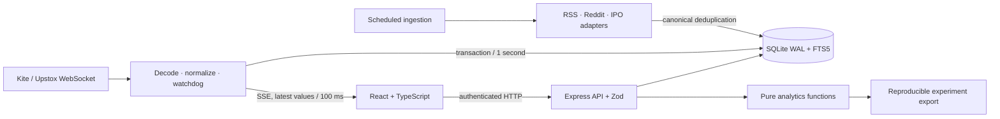

# Hedgeway

**An India-first investing workspace with live broker feeds, portfolio analytics, research ingestion and IPO tracking.**

[](https://github.com/ANUJ-DESHPANDE/hedgeway/actions/workflows/ci.yml)

Hedgeway brings Indian equities, a personal portfolio, source-linked research and quantitative experiments into one responsive workspace. It is a single-owner application with a real SQL database and authenticated API—not a static dashboard.

**There is no demo mode, fabricated price feed, prefilled portfolio or delayed-data fallback.** Without provider credentials, market data stays disconnected. Test fixtures exist only in `tests/`.

## Start locally

Install **Node.js 24+**, then run:

```sh
git clone https://github.com/ANUJ-DESHPANDE/hedgeway.git
cd hedgeway
npm ci
npm run setup
npm run build
npm start
```

Open **http://localhost:4100**. The setup command creates a private `.env` and a random token-encryption key without printing secrets. Default local access binds only to loopback. Windows, macOS and Linux use the same commands.

1. Open **Integrations** and select Upstox or Kite for market data.
2. For Upstox, enter an account-issued Analytics Token in the app's connection form. For Kite, configure its app credentials and sign in through Zerodha.
3. Add NSE trading symbols or BSE scrip codes in **Markets**, or import your real holdings CSV in **Portfolio**.
4. The selected broker stream connects automatically when credentials and instruments are present. Watch the connection banner and quote timestamps.
5. Refresh **Research** and **IPOs**, or leave the enabled scheduler running.

`npm run dev` runs Vite and the API with hot reload. Use the production command above for the Kite callback, whose default URL is `http://localhost:4100/api/kite/callback`.

## What works

| Area         | Implemented behavior                                                                                                                                                                                                                                                                                 |
| ------------ | ---------------------------------------------------------------------------------------------------------------------------------------------------------------------------------------------------------------------------------------------------------------------------------------------------- |
| Live markets | Upstox V3 protobuf or Kite v3 binary WebSocket adapter; server-side credentials; automatic reconnect; heartbeat watchdog; 100 ms UI batching; SQL snapshots every second; server-sent events to authenticated browsers                                                                               |
| Portfolio    | Kite holdings sync or review-before-save CSV import; NSE/BSE identity separation; acquisition cost, unrealised P&L, sector allocation, position concentration, uniform and API-level sector stress tests; missing prices never become zero                                                           |
| Research     | Economic Times, Moneycontrol and ValuePickr RSS adapters; approved Reddit OAuth adapter; canonical-URL deduplication; FTS5 search; short excerpts; bookmarks; symbol tagging and transparent lexicon sentiment                                                                                       |
| IPOs         | Real Xflot issue data; price bands, lots, dates and subscriptions; reported GMP with disputed-data flags; category detail and stored snapshots; historical GMP-versus-listing outcome study                                                                                                          |
| Strategy lab | Real broker daily prices or uploaded CSV; moving-average long/cash backtest with a full-bar signal delay, costs, drawdown, annualised volatility, Sharpe, historical VaR and expected shortfall; downloadable inputs, parameters, data fingerprint and results                                       |
| Journal      | Persistent investment theses, risk/invalidation notes, catalysts and NSE price alerts; alerts evaluated on stream persistence and explicit quote refresh                                                                                                                                             |
| Operations   | Database migrations, transactions and indexes; encrypted broker tokens; protected sessions; origin checks; request limits; job history; health endpoint; backup command; Docker deployment and CI                                                                                                    |
| Interface    | Company-name lookup, guided broker setup, useful first-launch screens, progressive disclosure of advanced tools, responsive dark/light workspace, lazy-loaded pages, keyboard navigation palette, focus-trapped dialogs, accessible labels, loading/error/empty states and visible source provenance |

### Live-data access

The code is fully integrated, but brokers still require account authorization:

- **Upstox:** the default provider. Its [Analytics Token](https://upstox.com/developer/api-documentation/analytics-token/) is read-only, free, and listed with one-year validity. Market data does not require a static IP. Generate it using your Upstox account and enter it in Integrations.
- **Kite:** personal portfolio APIs and the streaming-data entitlement are separate. Zerodha currently lists [streaming and historical access at ₹500/month](https://zerodha.com/products/api). The free Personal API can be used for holdings while Upstox supplies quotes. Kite access tokens expire daily; Hedgeway requires a fresh official login.

Broker credentials, account creation, subscriptions and exchange-data entitlements are not bundled with this repository. Free API use does not imply permission to redistribute exchange data publicly. Rates and access conditions can change; verify the linked provider documentation.

## Engineering overview



See [architecture and data contracts](docs/ARCHITECTURE.md), [analytics methodology](docs/ANALYTICS.md), [provider research](docs/PROVIDERS.md), [deployment](docs/DEPLOYMENT.md) and [verification status](docs/VERIFICATION.md).

## Commands

```sh
npm run setup                 # create local config and encryption key
npm run dev                   # Vite + API development
npm run check                 # tests, TypeScript and production frontend build
npm run ingest                # one bounded RSS + IPO ingestion pass
npm run backup -- ./backups/hedgeway.sqlite
```

The production deployment requires a persistent database volume, a strong workspace password, HTTPS and the original encryption key. Read the deployment guide before exposing it beyond localhost. This is a personal research application, not a multi-tenant brokerage or an order-execution system.

## Honest boundaries

Broker feeds deliver their own exchange snapshots and ticks; network latency, exchange hours, token expiry and outages still exist. The UI shows connection state and timestamps rather than promising perfect synchrony with another broker's terminal. IPO and news providers have different refresh schedules. GMP remains unofficial.

Portfolio P&L is an acquisition-cost snapshot, not cash-flow-adjusted performance, tax accounting or a full transaction ledger. The strategy lab tests one security and is not an investment recommendation. Browser visual QA and credentialed broker acceptance testing must be completed in the intended deployment; see verification notes for checks already executed.

## License and acknowledgments

MIT for original application code. Provider data and the upstream protocol schema retain their own terms; see [THIRD_PARTY.md](THIRD_PARTY.md). Product research informed the design; no Ghostfolio, OpenBB or other dashboard source code was copied.
